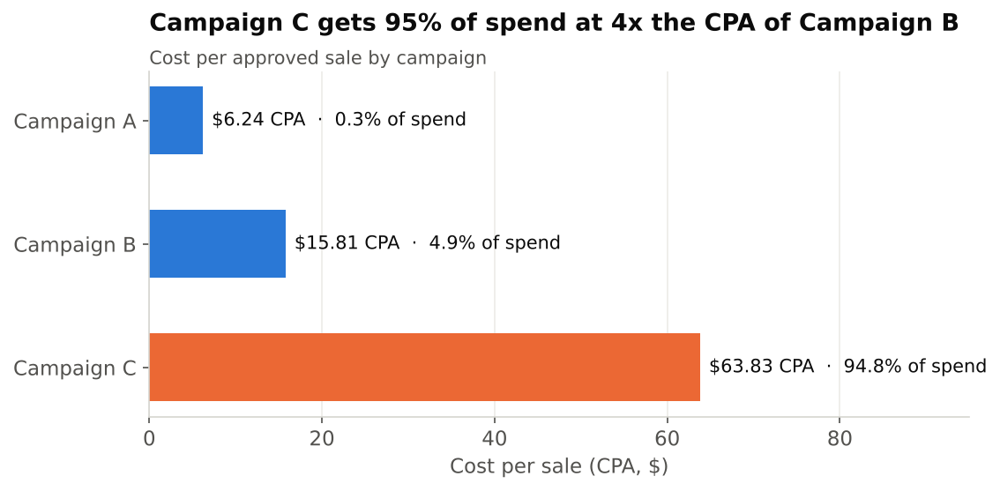
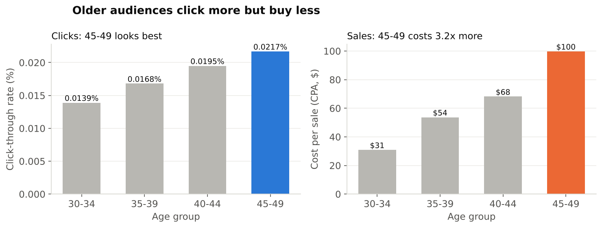
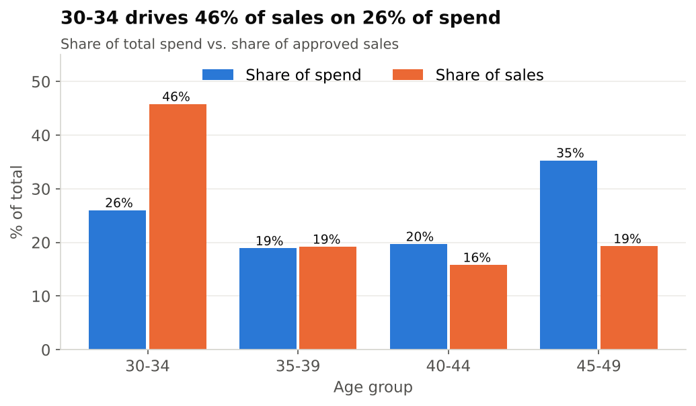
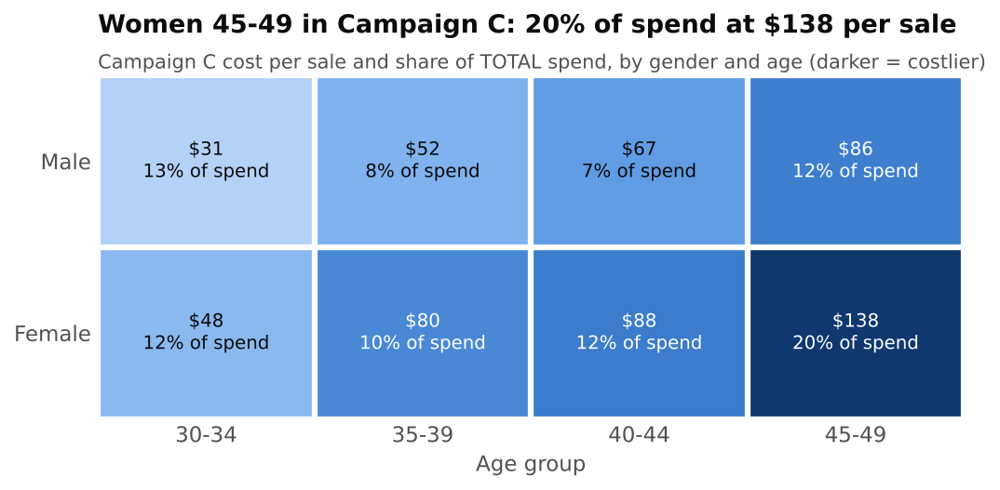

# Facebook Ad Spend Analysis: Moving Budget from Clicks to Customers

**TL;DR:** In this account, 95% of the budget goes to the least efficient campaign, and the audiences with the best click-through rates are the most expensive to convert. Moving budget toward Campaign B and the 30-34 age group could noticeably lower cost per sale. That should be confirmed with a holdout test before any large shift.

**Stack:** SQL (DuckDB) · Python (pandas, matplotlib) · Jupyter
**Data:** [Sales Conversion Optimization (Kaggle)](https://www.kaggle.com/datasets/loveall/clicks-conversion-tracking): 1,143 anonymised Facebook ads across 3 campaigns, $58.7k spend, 213M impressions, 3,264 leads, 1,079 sales.

## Headline metrics

| Campaign | Share of spend | CTR | Lead CVR | CPA (cost per sale) | ROAS* |
|---|---:|---:|---:|---:|---:|
| A | 0.3% | 0.023% | 51.3% | $6.24 | 16.0 |
| B | 4.9% | 0.024% | 27.1% | $15.81 | 6.3 |
| C | 94.8% | 0.018% | 7.4% | $63.83 | 1.6 |
| **Total** | 100% | 0.018% | 8.6% | **$54.41** | 1.8 |

*The dataset has no revenue column, so ROAS assumes $100 of revenue per sale. CPA needs no assumption and is the primary metric.

## Three insights

### 1. Budget is concentrated in the least efficient campaign
**Finding:** Campaign C takes 94.8% of spend ($55.7k) at a $63.83 CPA, **4.0x** Campaign B's $15.81.
**Action:** Move 10% of C's budget (about $5.6k) into B in two or three steps. Keep scaling only while B's marginal CPA stays under about $40. B has spent only $2.9k so far, so its CPA will probably rise as it grows.



### 2. CTR rewards the wrong audience
**Finding:** Ages 45-49 have the **highest CTR** (0.0217% vs 0.0139% for 30-34) and the **largest share of spend** (35%), but a **$99.76 CPA, 3.2x** the $30.88 for 30-34. The 30-34 group brings in 46% of sales on 26% of spend. The same ordering shows up in Campaigns B and C and for both genders, so it isn't the effect of a single campaign.
**Action:** Move $5k from 45-49 to 30-34. At average CPAs that is about **+112 sales**; treat that as an upper bound, because marginal CPA rises with scale.




### 3. One audience cell absorbs a fifth of the budget at a loss
**Finding:** Women aged 45-49 in Campaign C take **20.4% of all spend** ($12.0k) at **$137.76 per sale**, 4.5x men aged 30-34 in the same campaign ($30.77). At $100 per sale this cell loses money (ROAS 0.73).
**Action:** Halve this cell's budget, switch Campaign C's optimisation goal from clicks to conversions, and move the freed budget to 30-34.



## Method
1. **Clean** (`sql/01_clean.sql`): checked nulls (none), duplicate IDs (none) and logical consistency (clicks ≤ impressions, sales ≤ leads). Converted the file's old-Mac CR line endings to LF. Flagged 207 ads with $0 spend that still report conversions (probably view-through attribution); they are kept in the totals.
2. **Metrics** (`sql/02_metrics.sql`): CTR, lead CVR, approval rate, CPL, CPA and ROAS, computed from summed totals rather than averaged ratios, by campaign, age, gender and interest.
3. **Segments** (`sql/03_segments.sql`): campaign × age, campaign × gender, a gender × age grid for Campaign C, and the reallocation scenario.
4. **Charts and narrative** (`notebooks/analysis.ipynb`).

## Limitations
- No revenue data, so ROAS rests on the $100-per-sale assumption.
- No dates, so there is no trend or day-of-week analysis. There is no device or channel field either; everything is Facebook.
- Average CPA is not marginal CPA, so the reallocation figures are upper bounds and should be checked with a holdout or A/B test.
- Interest codes are anonymised, so interest-level results can't be mapped to named audiences.

## Reproduce
```bash
pip install duckdb pandas matplotlib jupyter
jupyter nbconvert --to notebook --execute notebooks/analysis.ipynb
# or run the SQL directly:
cat sql/01_clean.sql sql/02_metrics.sql sql/03_segments.sql | duckdb
```
